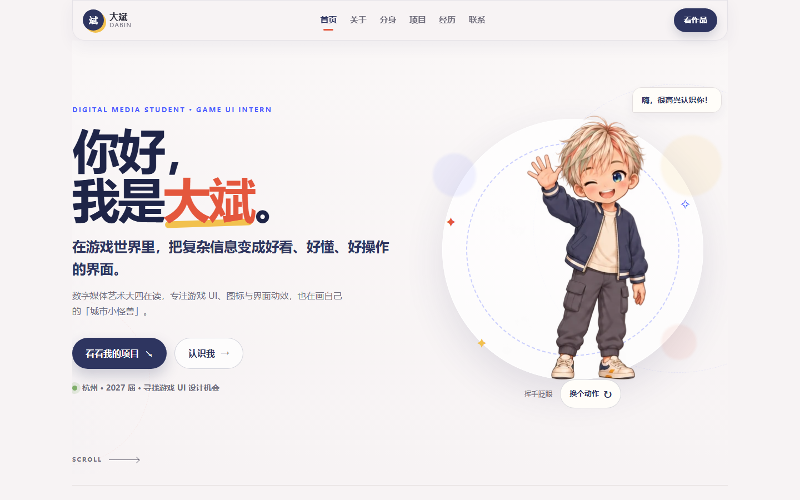

# 大斌 · 个人作品集

游戏 UI 视觉设计实习生 / 数字媒体艺术在读。这个仓库是一个纯静态个人网站，无构建步骤，直接托管在 **GitHub Pages**。

## 线上地址

- GitHub Pages：https://guobin09.github.io/dabin-portfolio/
- Cloudflare Pages：https://dabin-portfolio.pages.dev




## 目录结构

```text
.
├─ index.html                  单页长滚动站点（首屏 / 关于 / 分身 / 项目 / 经历 / 联系）
├─ assets/
│  ├─ styles.css               基础版式与配色
│  ├─ pages.css                各区块版面
│  ├─ refinements.css          人物展示、移动端布局、可访问性优化
│  ├─ playful.css              趣味插画与互动样式
│  ├─ script.js                动作切换、项目展开、导航与滚动状态
│  ├─ playful.js               工作室彩蛋、主题封面、大图浏览
│  ├─ favicon.svg              站点图标
│  ├─ character/               角色动作图集与三视图（透明 WebP）
│  └─ illustrations/           四张项目主题插画 + 工作台，各含 640px 缩略图
├─ preview-desktop.png         桌面端预览截图
├─ preview-mobile.png          移动端预览截图
└─ .nojekyll                   关闭 Jekyll 处理，保证 assets 原样发布
```

## 技术说明

- 纯 HTML / CSS / 原生 JavaScript，**无框架、无打包、无依赖**。
- 角色使用 6 动作图集（4 列 × 2 行透明 WebP），通过 `background-position` 切换，避免多张图重复下载。
- 图片按视口加载两种尺寸（`-640.webp` 与全尺寸），配合 `loading="lazy"` 控制首屏体积。
- 尊重系统「减少动态效果」设置；JavaScript 不可用时仍可正常阅读全部内容。
- 使用相对路径引用资源，因此既能挂在 `https://guobin09.github.io/dabin-portfolio/` 这种子路径下，也能直接部署在域名根目录。

## 本地预览

直接双击 `index.html`，或在目录内起一个静态服务：

```powershell
python -m http.server 8080
# 打开 http://localhost:8080
```

## 更新流程

```powershell
git add -A
git commit -m "update: 修改说明"
git push
```

推送到 `main` 后 GitHub Pages 会自动重新发布，约 1 分钟后生效。

## 内容说明

学校、公司、项目、奖项与联系方式沿用课程练习中的模拟资料，页面保留说明。后续完善内容时，应替换为真实经历、项目截图与联系入口。
